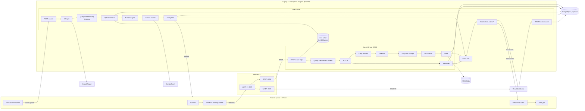
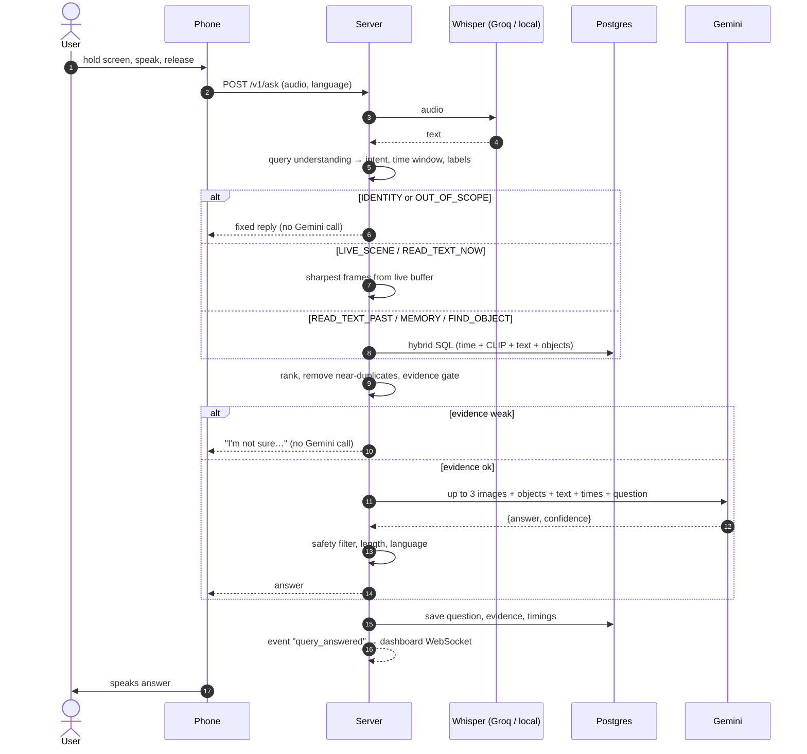
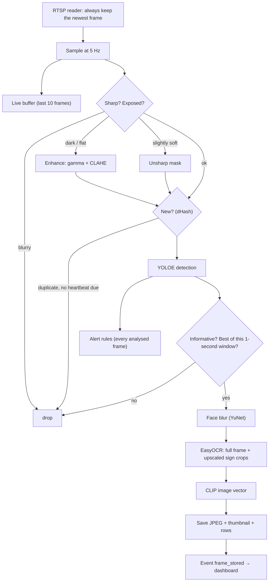
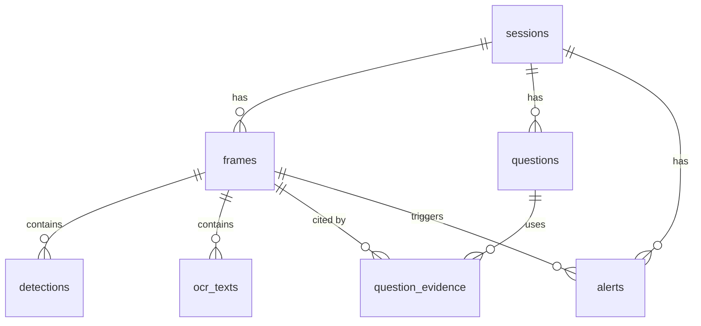

# Vision Assistant — System Design (v3)

> **An AI that describes the world out loud.** A phone streams live video to a laptop. The laptop remembers what it saw. The user asks a question by voice and hears a short, honest answer.

| | |
|---|---|
| **Course** | Multimedia Databases and Image Processing — Fall 2026/2027 |
| **Status** | v3.0 — the baseline for all work. Replaces v1 and v2. |
| **Date** | 2026-11-03 |
| **Deadline** | **Wed 2026-11-25** (code freeze Tue Nov 24, 18:00) |
| **Team** | 3 members, part-time (other courses in parallel) |
| **Hardware** | Android phone + Windows laptop with a 4–6 GB NVIDIA GPU, same Wi-Fi |
| **Budget** | Free tiers only |

**Ground rules for this document:**

1. **Latency is not graded** (confirmed by the instructor). When accuracy or robustness conflicts with speed, choose accuracy and robustness. Speed is still measured and reported, because the spec asks for it in the test results.
2. If code and this document disagree, fix one of them in the same PR.
3. Coding agents must read this file before working on any component (§12).

---

## Contents

1. [The system in one page](#1-the-system-in-one-page)
2. [Review of the original draft](#2-review-of-the-original-draft)
3. [Requirements checklist](#3-requirements-checklist)
4. [Technology choices](#4-technology-choices)
5. [Architecture](#5-architecture)
6. [Components](#6-components)
7. [Multimedia database](#7-multimedia-database)
8. [API and WebSocket contracts](#8-api-and-websocket-contracts)
9. [Privacy and honesty](#9-privacy-and-honesty)
10. [Budgets: GPU, quota, fallbacks](#10-budgets-gpu-quota-fallbacks)
11. [Evaluation (test results)](#11-evaluation-test-results)
12. [Repository and working with agents](#12-repository-and-working-with-agents)
13. [Team](#13-team)
14. [Schedule](#14-schedule)
15. [Risks](#15-risks)
16. [Demo script](#16-demo-script)
17. [Check on day 1](#17-check-on-day-1)
18. [Appendices](#18-appendices)

---

## 1. The system in one page

| Piece | What it is | Owner |
|---|---|---|
| **Phone app** | Flutter (Android). Streams the camera over **WebRTC**, records questions, speaks answers and alerts. Talks to the server over **HTTP + a WebSocket**. | M1 |
| **MediaMTX** | Ready-made media server (one `.exe` + config). Receives WebRTC from the phone, gives RTSP to the server and WebRTC (WHEP) to the dashboard. | M1 |
| **Server** | **One Python program** (FastAPI). A **background thread** (the *ingest worker*) turns the stream into stored frames. **Web routes and WebSockets** answer questions and feed the dashboard. | M2 (ingest, DB) + M3 (assistant) |
| **PostgreSQL + pgvector** | The multimedia database, in Docker. Frames, objects, OCR text, vectors, questions, alerts. | M2 |
| **Dashboard** | React + Vite. Live video, status, frame timeline with search, Q&A history, alerts. | M1 |
| **Cloud (free)** | **Groq Whisper** (speech → text), **Gemini Flash** (writes answers from images) | M3 |

**The loop (from the spec):**

1. **Stream:** the phone publishes its rear camera to MediaMTX over WebRTC (WHIP).
2. **Remember:** the ingest worker reads the stream at 5 frames/s. It checks sharpness and exposure, brightens dark frames, and checks the frame is new (perceptual hash). It then detects objects (YOLOE) and keeps the best informative frame of each second. Faces are blurred, text is read (EasyOCR + upscaled sign crops) and a CLIP vector is computed. Everything is stored in Postgres; frames older than 30 min are deleted.
3. **Ask:** the user holds the screen and speaks. The app uploads the audio. **Whisper** (Groq, with a local fallback) turns it into text.
4. **Answer:** the **query-understanding** step works out the **intent**, time window and target objects. **Hybrid retrieval** finds the right frames, and an **evidence gate** checks they're good enough. **Gemini** writes a short grounded answer, a **safety filter** checks it, and the phone speaks it.

**Bonus:** spoken warnings without being asked ("Door ahead"), pushed over the WebSocket. Measured before/after results for image enhancement.

---

## 2. Review of the original draft

The 2-minute draw.io draft had these errors. All are fixed in this design and in [`docs/architecture.drawio`](docs/architecture.drawio).

| # | Draft | Problem | Fix |
|---|---|---|---|
| 1 | Whisper produces "Voice Output" | Whisper is speech-*to-text*. Nothing spoke the answer. | Whisper for input. `flutter_tts` on the phone for output. |
| 2 | "Image Stream" with no protocol | The spec requires WebRTC/RTSP/HLS, and the dashboard needs the stream too. | MediaMTX: WebRTC in, RTSP + WebRTC out. |
| 3 | No OCR | Reading signs is a core requirement. | EasyOCR + crop pre-processing. |
| 4 | ResNet-50 to "extract" | ResNet vectors can't be compared with a spoken question, so "search by meaning" was impossible. | Multilingual CLIP (images and text share one vector space). |
| 5 | Plain YOLO | COCO has no door / stairs / sign classes. | YOLOE with our own class list. |
| 6 | "S1.Mini transcript cleanup" | An unclear extra model with little benefit. Whisper output is already clean. | Replaced by **query understanding** (§6.5.2), which *interprets* the question instead of rewording it. |
| 7 | "Filtering Images" undefined, placed before YOLO | "Informative" depends on detections, so it can't all happen before YOLO. | Two-stage selection (§6.3.2). |
| 8 | Two DB boxes | Mixed up short-term live frames with long-term memory. | In-memory live buffer + Postgres + retention. |
| 9 | Response model fed only from the DB | The VLM needs the actual images, and "now" questions need the *latest* frame. | Evidence frames + context to Gemini (§6.5.4). |
| 10 | Server language undecided | — | Python 3.12. |
| 11 | Missing: enhancement, "not sure", never "safe", languages, retention, no face recognition, metrics | All are spec requirements. | See §3. |

**What changed in v3 compared with v1 and v2:**
- **Kept from v1:** PostgreSQL + pgvector, WebSockets, the 7-intent query understanding, the evidence gate, weighted hybrid ranking, React dashboard, face blurring, OCR crop pre-processing, fuller frame selection, Whisper fallback, template-answer fallback.
- **Kept from v2:** one server process instead of two, so **no Redis** (the live buffer and event hub live in memory), and a right-sized evaluation (30–40 questions).
- **Dropped from v1:** the separate e5 text-embedding model (OCR text is searched with Postgres full-text + trigram instead), the API token, and a local VLM.

---

## 3. Requirements checklist

**Must** = required by the spec. **Bonus** = extra marks. **Optional** = only if ahead.

| Spec requirement | How | § | Priority | Owner |
|---|---|---|---|---|
| Stream the phone camera live (WebRTC/RTSP/HLS) | Flutter WHIP → MediaMTX → RTSP | 6.1, 6.2 | Must | M1 |
| Listen to the question, speak the answer | Hold-to-talk + `flutter_tts` | 6.1 | Must | M1 |
| Keep only useful frames (sharp, new, informative) | Two-stage frame selection | 6.3.2 | Must | M2 |
| Improve poor frames | Gamma + CLAHE (dark), unsharp mask (soft), sign-crop pre-processing | 6.3.3 | Must (basic) / Bonus (measured) | M2 |
| Read signs (OCR) | EasyOCR `['ar','en']` + crops + Arabic normalization | 6.3.5 | Must | M2 |
| Detect objects | YOLOE open-vocabulary | 6.3.4 | Must | M2 |
| Store frames with text, objects and time | Postgres + pgvector schema + JPEG folder | 7 | Must | M2 |
| Find frames by time or by meaning | Time index, CLIP vectors (HNSW), full-text + trigram, object labels | 7.4 | Must | M2 |
| Speech to text | Groq Whisper + local faster-whisper fallback | 6.5.1 | Must | M3 |
| VLM answers only from what the camera saw | Gemini with a strict prompt + JSON | 6.5.4 | Must | M3 |
| Say "I'm not sure" when evidence is weak | Evidence gate + Gemini confidence | 6.5.5 | Must | M3 |
| Never say "safe" | Prompt rule + phrase filter | 6.5.5 | Must | M3 |
| At least two languages | **English + Arabic**; French optional | 6.5.6 | Must | M3, M1 |
| Accessible mobile app | Whole-screen button, sounds, vibration, TalkBack | 6.1.3 | Must | M1 |
| Dashboard: live status, timeline, past Q&A, live stream | React dashboard + WebSocket + REST + WHEP | 6.7 | Must | M1 |
| No face recognition | No identity model; `IDENTITY` intent refused in code; faces blurred | 9 | Must | M3, M2 |
| Delete old frames | Retention job (30 min) + "Delete all" | 7.5 | Must | M2 |
| Test only with people who agree | Consent screen + consent stored + paper form | 9 | Must | M1 |
| Repo + README, presentation, test results, demo, responsibilities | §11–§16 | | Must | All |
| Warnings without being asked | Alert rules → WebSocket push | 6.6 | Bonus | M3 |
| Pre-processing blurry/dark images | Enhancement + before/after results | 6.3.3, 11 | Bonus | M2 |

---

## 4. Technology choices

| Area | Choice | Why | Rejected |
|---|---|---|---|
| Server | **Python 3.12**, FastAPI, `uv` | All ML libraries are Python-first. Don't use the laptop's Python 3.14: GPU wheels lag behind. | Node, Go |
| Audio uploads | **python-multipart** | FastAPI needs it to read the `/v1/ask` upload (multipart form, §8.1). | Parsing the form by hand |
| Server structure | **One process**: FastAPI + an ingest **background thread** | One thing to start and debug. Events and the live buffer stay in memory, so no Redis. The ingest code is a separate module, so it could be moved to its own process later if needed. | Two processes + Redis (more moving parts) |
| Media server | **MediaMTX** | WebRTC/WHIP in; RTSP and WebRTC/WHEP out. No code. | aiortc, Janus, LiveKit |
| Phone → server video | **WebRTC (WHIP)**, H.264, video only, 720p | Required by the spec; low latency on a LAN. | RTMP (not on the spec's list) |
| Phone/dashboard ↔ server messages | **WebSockets** (alerts, status, new frames, answers) + HTTP for uploads and queries | Instant push for alerts and the live dashboard. | Polling |
| Mobile | **Flutter**, Android | Team's choice. | — |
| Dashboard | **React + Vite + TypeScript + Tailwind** | Good UI, agents are strong at it, native browser WebRTC. | Flutter Web |
| Database | **PostgreSQL 16 + pgvector + pg_trgm** (Docker) | Time, vectors, full-text and fuzzy text in **one SQL query**. The strongest choice for a multimedia-DB course. | SQLite (less to show), separate vector DB |
| Image files | JPEG on disk, path in the DB | Simple; retention deletes both. | BLOBs in Postgres |
| Objects | **YOLOE** (Ultralytics) | Open vocabulary: door, stairs, sign… | COCO YOLO (no door class) |
| OCR | **EasyOCR** `['ar','en']` | Same PyTorch stack; one reader covers both required languages. | PaddleOCR (CUDA conflicts on Windows), Tesseract |
| Image ↔ text vectors | **CLIP ViT-B/32** + **`clip-ViT-B-32-multilingual-v1`** (sentence-transformers) | Arabic/English/French questions match images. Small. | ResNet-50 |
| Face blurring | **OpenCV YuNet** face *detector* | Tiny, CPU, detection only (no recognition). | — |
| Speech to text | **Groq `whisper-large-v3-turbo`** (free) + **faster-whisper `medium`** (local CPU fallback) | Best accuracy for zero VRAM, and still works if the internet or quota fails. | Local only (weaker Arabic, VRAM) |
| Answer writer | **Gemini `gemini-3.6-flash`** (free), backup `gemini-3.5-flash-lite`, last resort a template answer | Free, reads images, multilingual, JSON output. | Claude/GPT (no free API tier) |
| Question understanding | **Rules + keyword lists** (EN/AR/FR) | Deterministic, testable, no quota used. | An extra LLM call |
| Text to speech | **`flutter_tts`** on the phone | Free, offline, instant. | Server TTS |

---

## 5. Architecture

### 5.1 Components



### 5.2 What runs on the laptop

| Process | How | Ports |
|---|---|---|
| MediaMTX | `mediamtx.exe infra/mediamtx.yml` | 8889 (WebRTC HTTP), 8189/udp (WebRTC media), 8554 (RTSP, local) |
| PostgreSQL 16 + pgvector | Docker `pgvector/pgvector:pg16` | 5432 (local) |
| Server (FastAPI + ingest thread) | `uv run python -m server` | 8000 (REST, WebSockets, built dashboard, images) |
| Dashboard dev server (development only) | `npm run dev` | 5173 |

`start.ps1` starts Docker Postgres, MediaMTX and the server, in that order. For the demo, the dashboard is built (`npm run build`) and served by FastAPI at `/`.

**Windows Firewall:** allow inbound 8000, 8889, 8189/udp on the **Private** profile, and set the demo network as Private.

### 5.3 How the thread and the web routes share things

- **Live buffer:** `collections.deque(maxlen=10)` of `(timestamp, jpeg_bytes, sharpness, detections)`, protected by a `threading.Lock`. The ingest thread writes; the `/v1/ask` route reads.
- **Event hub:** the ingest thread calls `hub.publish(event)`. That uses `loop.call_soon_threadsafe(...)` to hand the event to the asyncio loop, which sends it to every connected WebSocket (phone and dashboard).
- **Database:** the ingest thread has its own `psycopg` connection. Web routes use a `psycopg` async connection pool.
- **GPU models** (YOLOE, EasyOCR, CLIP image encoder) are loaded **inside the ingest thread**. The web side loads only the CLIP *text* encoder (CPU) and the faster-whisper fallback (CPU, loaded on first use).
- If the web routes ever feel sluggish because the thread is busy, lower `SAMPLE_HZ`. Latency isn't graded, so this is a tuning knob, not a redesign.

### 5.4 Asking a question



---

## 6. Components

### 6.1 Phone app — M1

#### 6.1.1 Screens
1. **Consent** (first launch, and whenever the consent text changes). It explains: video goes to the team's laptop; frames are deleted after 30 min; faces are blurred; images and questions are sent to Google Gemini and Groq, whose free tiers may use the data; no face recognition. "I agree" stores the time, and it's sent with the session.
2. **Main:** the whole screen is one button. Status text at the top for sighted helpers.
3. **Settings** (corner button): server IP, language (English / العربية / Français), speech rate, alerts on/off.

#### 6.1.2 Behavior
- On start: `POST /v1/sessions`, start WebRTC streaming, open the WebSocket `/v1/ws/phone`. Then say "Connected. Hold the screen to ask a question." and, once per launch, "This is a helper, not a replacement for your cane or guide dog."
- **Hold to talk:** press → beep + vibrate + start recording; release → beep + upload. Ignore taps shorter than 0.4 s; stop recording at 10 s.
- Waiting: a soft tick every 1.5 s. Answer: speak it in the answer's language. A new press stops the speech (barge-in).
- **Alerts** arrive on the WebSocket: strong vibration, then speak. An answer being spoken has priority over an alert.
- Connection lost (stream or WebSocket): say "Connection lost. Reconnecting." and retry after 1, 2, 4, 8 s. Say "Connected" when back.
- Errors: always speak the `speak` text from the server, so the user is never left in silence.
- Keep the screen awake; portrait; rear camera.

#### 6.1.3 Accessibility checklist (test with TalkBack on)
- [ ] Every control has a `Semantics` label and hint.
- [ ] With TalkBack, "hold" becomes **double-tap-and-hold**. Check it still works.
- [ ] Every state change has a sound, vibration or speech.
- [ ] Whole screen is the button; text ≥ 20 sp; high contrast.
- [ ] **Arabic voice installed** on the demo phone (Settings → Text-to-speech → Google → Install voice data).

#### 6.1.4 Packages
`flutter_webrtc`, `http`, `web_socket_channel`, `record` (WAV 16 kHz mono), `flutter_tts`, `wakelock_plus`, `permission_handler`, `audioplayers`, `shared_preferences`.

Request **video only** in WebRTC (`audio: false`). The microphone is used by `record` for questions.

### 6.2 Streaming — M1

**Publishing from the app (WHIP):**
1. `getUserMedia({video: {facingMode: 'environment', width: 1280, height: 720, frameRate: 24}, audio: false})`
2. Create an `RTCPeerConnection`, add the track as send-only, and prefer **H.264**.
3. Create the offer and wait for ICE gathering to finish.
4. `POST http://<laptop-ip>:8889/phone/whip` with `Content-Type: application/sdp` and the offer as the body. The response body is the SDP answer; the `Location` header is the URL to `DELETE` when stopping.
5. `setRemoteDescription(answer)`. Set the bitrate to ~1.5–2 Mbps.

**MediaMTX config (`infra/mediamtx.yml`, key parts):**

```yaml
webrtc: yes
webrtcAddress: :8889
webrtcLocalUDPAddress: :8189
webrtcAdditionalHosts: [ "192.168.1.10" ]   # laptop's LAN IP — change per network
rtsp: yes
rtspAddress: :8554
paths:
  phone:
    source: publisher
```

**Dashboard playback:** a small WHEP client in React (`POST` an offer to `http://<ip>:8889/phone/whep`, show the remote track in a `<video>`). Quick fallback: `<iframe src="http://<ip>:8889/phone">` (MediaMTX's own player page).

**Working without the phone** (so M2 and M3 never wait for M1):

```bash
ffmpeg -re -stream_loop -1 -i data/videos/walk_01.mp4 -c:v libx264 -preset veryfast -tune zerolatency -f rtsp rtsp://localhost:8554/phone
```

**Plan B:** if streaming from Flutter isn't working by **Nov 7**, stream with the free **Larix Broadcaster** app (WebRTC/WHIP or RTSP), and keep our app for voice, alerts and TTS. Tell the instructor honestly if you use it.

### 6.3 Ingest thread — remembering frames — M2

#### 6.3.1 Pipeline



**Reading the stream:** run `cv2.VideoCapture(url, cv2.CAP_FFMPEG)` in its own small loop that keeps calling `grab()` and keeps only the newest frame (OpenCV otherwise buffers old frames). Set `OPENCV_FFMPEG_CAPTURE_OPTIONS="rtsp_transport;tcp"`. If no frame arrives for 3 s, reconnect and send a `status` event with `stream_connected: false`.

#### 6.3.2 Frame selection — "sharp, new and informative"

Metrics are computed on a grayscale copy resized to 640 px wide. All thresholds live in `server/config.yaml` and are **saved with each frame**, so they can be tuned and reported.

| Check | Technique | Rule (defaults, tune on your videos) |
|---|---|---|
| **Sharp** | Variance of the Laplacian (edge strength) | adaptive: `≥ max(60, 0.6 × median of the last 50 frames)`. Between 0.6× and 1× → unsharp mask (§6.3.3). Below → drop. |
| **Exposed** | mean brightness μ, standard deviation σ | `μ < 60` or `σ < 25` → enhance first; `μ > 220` → drop |
| **New** | **dHash** (64-bit perceptual hash), Hamming distance to the last saved frame | `≥ 12` → new; `≤ 5` → duplicate |
| **Informative** | YOLOE detections, sign regions, edge density | ≥ 1 detection with conf ≥ 0.35, **or** a `sign` / `exit sign` box, **or** edge density (Canny) ≥ 0.04. Rejects blank walls, floors and ceilings. |
| **New objects** | label set vs the last saved frame | a new label appears → keep, even if the dHash distance is small |
| **Best of window** | — | within each 1 s window, keep only the **sharpest** passing frame (big win while walking) |
| **Heartbeat** | time since the last saved frame | keep one sharp frame every 10 s even if similar, so the timeline has no gaps |

Each frame stores `keep_reason` (`novel`, `new_objects`, `text`, `heartbeat`). Expect to keep **5–15 %** of sampled frames. Report the real number.

#### 6.3.3 Image enhancement

| Condition | Operation | Parameters |
|---|---|---|
| Dark (`μ < 60`) | **Gamma** correction, then **CLAHE** on the L channel (LAB colour space) | γ = 0.6–0.8 depending on μ; CLAHE clip 2.0, tiles 8×8 |
| Low contrast (`σ < 25`) | CLAHE on L | clip 2.0 |
| Slightly soft | **Unsharp mask** | Gaussian σ = 1.0, amount 1.0 |
| Strong motion blur | **Dropped, not fixed** | Deblurring is slow and unreliable. Say so in the report. |
| **Sign crops for OCR** | Upscale ×2 (cubic), CLAHE, light denoise (`fastNlMeansDenoising`, h = 7) | Only on `sign` / `exit sign` / `room number sign` boxes |

Store `enhanced` and `enhance_ops` (e.g. `{gamma,clahe}`), so the evaluation can compare before and after (§11). Gemini always receives the enhanced version.

#### 6.3.4 Object detection — YOLOE

- Model `yoloe-26s-seg.pt` (fall back to `yoloe-11s-seg.pt` if needed), FP16, `imgsz=640`, run on every frame that passes the quality checks (~5 per second).
- Class list, set once with `model.set_classes([...])`. Keep it under ~40; longer lists hurt accuracy:
  `person, door, stairs, elevator, escalator, chair, table, desk, bench, sofa, toilet, sink, trash can, sign, exit sign, room number sign, traffic light, car, bus, bicycle, motorcycle, pole, window, laptop, phone, bottle, cup, backpack, bag, book, keys, wallet, umbrella, dog, cat, plant`
- Store for each detection: label, confidence, normalized box, `area_ratio` (box area / image area), `position` (left / center / right by box center).
- **Spike on Nov 3–5:** run YOLOE on the first test videos. Check `door` and `stairs` are found at conf ≥ 0.3. If they aren't, try other wordings ("wooden door", "glass door", "staircase").
- `person` is just an object class. There is no identity, age, gender or emotion model anywhere.

#### 6.3.5 OCR — EasyOCR

- One reader: `easyocr.Reader(['ar','en'], gpu=True)`. In EasyOCR, Arabic can only be combined with English, and that covers both required languages.
- Run on the full saved frame (long side ≤ 1280 px) **and** on the pre-processed sign crops (§6.3.3). Merge overlapping results (IoU > 0.5 → keep the more confident one).
- Keep lines with confidence ≥ 0.4 and length ≥ 2.
- **Normalization** (`server/common/text_norm.py`, used when storing *and* when searching):
  - lowercase, strip Latin accents (for matching only; the original is stored too);
  - Arabic: remove diacritics and tatweel; `أ إ آ → ا`, `ى → ي`, `ة → ه`; Arabic-Indic digits → 0–9;
  - collapse spaces.
- Optional French: a second reader `['fr','en']` on CPU, sign crops only.
- Honest note: EasyOCR's Arabic is mediocre. That's acceptable: OCR mainly **finds** frames, and Gemini **re-reads the image** when answering.

#### 6.3.6 Face blurring

OpenCV `cv2.FaceDetectorYN` (YuNet ONNX model, ~300 KB, CPU). It runs on every saved frame **before** the frame is written to disk or sent anywhere. Each face box gets a strong Gaussian blur, and the number of faces is stored in `faces_blurred`. This is face *detection* used to protect bystanders, not recognition.

#### 6.3.7 Embeddings

| Vector | Model | Where |
|---|---|---|
| frame `clip_emb` (512) | `sentence-transformers/clip-ViT-B-32` image encoder, on the saved (blurred, enhanced) frame | GPU, ingest thread |
| question vector (512) | `sentence-transformers/clip-ViT-B-32-multilingual-v1` text encoder | CPU, web side |

Normalize vectors (length 1) before storing, so cosine similarity = dot product.

#### 6.3.8 Live buffer

Every sampled frame (5 per second) goes into the live buffer: JPEG quality 80, 960 px wide, with its timestamp, sharpness and detections. It holds the last ~2 s. For "now" questions, the server takes the **sharpest of the last 5**.

### 6.4 Server web side — M3

FastAPI with the routes and WebSockets in §8. On startup it: connects the Postgres pool, loads the CLIP text encoder, starts the ingest thread, and starts the event hub. Groq and Gemini calls use async clients with timeouts (STT 15 s, Gemini 30 s; generous, since latency isn't graded).

### 6.5 AI assistant pipeline — M3

#### 6.5.1 Speech to text (Whisper)

- **Primary:** Groq `whisper-large-v3-turbo`, `temperature=0`, `response_format="verbose_json"`. **Pass `language`** from the app setting (`en` / `ar` / `fr`). Whisper often guesses the language wrong on short clips, especially dialectal Arabic.
- **Fallback:** if Groq fails or is rate-limited, run local `faster-whisper` `medium` with `compute_type="int8"` on the CPU. It takes several seconds, which is acceptable. It's loaded on first use so it doesn't take RAM otherwise.
- Empty or nonsense transcript (no letters, or very low confidence) → "Sorry, I didn't catch that. Please try again." in the app language.
- Audio is **deleted right after transcription** and never stored.
- Save `stt_engine` (`groq` / `local`) with the question, for the report.

#### 6.5.2 Query understanding — the 7 intents

**Why this step exists.** Whisper gives us text, but the server still has to decide **where to look and how**. "What's in front of me?" should use the live camera, not memory. "The door I just passed" means the last ~90 seconds, not the last 30 minutes. "Did you see my keys?" should filter by the detected object `keys`. "Who is this?" must be refused **in code**, without trusting the AI to refuse. This step makes those decisions with simple, testable rules, *before* Gemini sees anything. Gemini only has to write the answer, not guess where to look.

It's rule-based: ordered keyword and regex lists per language in `server/assistant/lexicon/{en,ar,fr}.yaml` (Appendix B). No AI model, so it uses no quota and gives the same result every time.

**Output:** `{intent, lang, t_from, t_to, target_labels[], search_text}`

| Intent | Examples (EN / AR / FR) | Where it looks | Time window | Calls Gemini? |
|---|---|---|---|---|
| `LIVE_SCENE` | "What's in front of me?" / "شو في قدامي؟" / "Qu'y a-t-il devant moi ?" | live buffer (sharpest of last 5) + current detections | now | yes |
| `READ_TEXT_NOW` | "Read this" / "شو مكتوب هون؟" / "Lis ce panneau" | live buffer, preferring frames with sign boxes, + newest saved frame with OCR from the last 5 s | now | yes |
| `READ_TEXT_PAST` | "What did that sign say?" / "شو كان مكتوب عاللافتة؟" / "Que disait le panneau ?" | Postgres: frames that have OCR text, ranked by text match + recency | last 3 min (or as parsed) | yes |
| `MEMORY` | "What was on the door I just passed?" / "شو شفنا قبل شوي؟" | Postgres hybrid search (meaning + text + objects + recency) | parsed (e.g. "just" → last 90 s, excluding the last 3 s) | yes |
| `FIND_OBJECT` | "Did you see my keys?" / "وين شفت المفاتيح؟" / "As-tu vu mes clés ?" | Postgres: object label filter + CLIP | whole retention window | yes |
| `IDENTITY` | "Who is this?" / "مين هيدا؟" / "Qui est-ce ?" | nothing | — | **no**: fixed refusal |
| `OUT_OF_SCOPE` | "What's the capital of France?" | nothing | — | **no**: fixed reply |

**How the rules work:**
1. Check `IDENTITY` keywords first (the refusal always wins).
2. Look for **past-tense markers** (`did, was, passed, earlier, saw` / `كان، شفت، مرقنا، قبل` / `était, avons vu, passé`). These move "read" questions to `READ_TEXT_PAST` and "what is there" questions to `MEMORY`.
3. Match intent keywords in order: `FIND_OBJECT` → `READ_TEXT_*` → `LIVE_SCENE` → `MEMORY`.
4. **Time expressions:** "just / a moment ago / قبل شوي / من شوي / tout à l'heure" → last 90 s. "a minute ago / قبل دقيقة / il y a une minute" → 30–150 s ago. "N minutes ago" → N±1 min. "earlier / before / قبل / avant" → whole retention window. Times count back from when the question was asked.
5. **Target labels:** a small synonym table maps words to YOLOE classes (`keys ↔ مفاتيح ↔ clés`, `door ↔ باب ↔ porte`, `stairs ↔ درج ↔ escaliers`…).
6. `OUT_OF_SCOPE`: general-knowledge patterns ("capital of", "who won", "what is the weather"…).
7. **If nothing matches:** `MEMORY` with a 3-minute window, **plus** the newest live frame. A wrong guess here still usually works.

Unit-test this module with **≥ 40 example sentences** across EN and AR (+ FR if done). Demo questions most often go wrong here, and testing it is cheap.

#### 6.5.3 Retrieval and ranking

1. **Candidates:** the hybrid SQL in §7.4, restricted to the intent's time window, top 30.
2. **Score each candidate.** Each part is min-max scaled to 0–1 across the candidates, because raw CLIP similarities are squeezed into ~0.15–0.35:

   `score = w_clip·clip + w_text·text_match + w_obj·object_match + w_rec·recency + w_q·sharpness`

   where `recency = exp(−seconds_ago / 60)`.

3. **Weights per intent** (starting values; tune on the test questions):

   | Intent | w_clip | w_text | w_obj | w_rec | w_q |
   |---|---|---|---|---|---|
   | READ_TEXT_PAST | 0.15 | 0.55 | 0.05 | 0.20 | 0.05 |
   | MEMORY | 0.40 | 0.20 | 0.15 | 0.20 | 0.05 |
   | FIND_OBJECT | 0.25 | 0.05 | 0.50 | 0.15 | 0.05 |

4. **Remove near-duplicates:** drop a candidate within 2 s of a better one, or with dHash distance ≤ 8 to one. Keep the **top 3**.
5. Return each frame with its time, OCR lines, objects (with position) and score parts. The dashboard shows the score parts, so you can explain *why* a frame was picked.

#### 6.5.4 Answer generation — Gemini

- SDK `google-genai`. Model `gemini-3.6-flash`; on a 429 or 5xx error, retry once with `gemini-3.5-flash-lite`; if that also fails → template answer (§10.3).
- Up to **3 images**, ≤ 1024 px on the long side, each labelled: `Frame A — 12 seconds ago — objects: door (center 0.82), sign (left 0.71) — text: "Room 204", "Computer Lab"`.
- Settings: `temperature=0.2`, JSON output with a schema, the model's **default thinking** (better grounding, and the extra seconds don't matter).
- The prompt (Appendix A) tells Gemini: use only these frames; never say "safe"; say you're not sure if unclear; at most 2 short sentences; answer in the user's language; quote sign text exactly; don't identify people.
- Reply schema: `{"answer": str, "confidence": "high"|"medium"|"low", "used_frames": [str], "reason_if_unsure": str}`.

#### 6.5.5 Honesty — "I'm not sure" and never "safe"

Three layers:

1. **Evidence gate (before Gemini):** if there are no candidates, or the best score is below `EVIDENCE_MIN` (start at 0.35; set it with the test questions), or the stream is down on a "now" question → answer from a template **without calling Gemini**. For example: "I'm not sure. I haven't seen a sign in the last few minutes." This saves quota and stops Gemini making things up from bad frames.
2. **Gemini's own confidence:** `low` → make sure the answer starts with "I'm not sure" (localized: "مش متأكد", "Je ne suis pas sûr").
3. **Safety filter (after Gemini, and on every alert):** a list of forbidden phrases in EN/AR/FR (Appendix C). On a match, replace that sentence with "I can't tell if it's safe. Please use your cane." (localized). Every trigger is logged and counted in the report.

Fixed replies (localized): `IDENTITY` → "I can't identify people, but I can tell you what I see." `OUT_OF_SCOPE` → "I can only answer questions about what the camera has seen."

#### 6.5.6 Languages

- **Required: English + Arabic. Optional: French** (Whisper and Gemini already handle it; it needs the lexicon file, a TTS voice and optionally the French OCR reader).
- The app's language setting decides the Whisper language and the answer language.
- Lebanese Arabic: the lexicon includes common dialect words (شو، وين، هيدا، هون، قدامي، شي). Gemini usually answers in standard Arabic, which TTS reads well.
- The dashboard shows Arabic with `dir="auto"` (right-to-left).

### 6.6 Proactive warnings (bonus) — M3

The rules run in the ingest thread on **every analysed frame** (5 per second), not just saved ones.

| Alert | Trigger (all must hold) | Message (EN) | Wait before repeating |
|---|---|---|---|
| `door_ahead` | `door` conf ≥ 0.45, in the center third, covers ≥ 18 % of the image, seen in ≥ 3 of the last 5 frames | "Door ahead." | 15 s |
| `stairs_ahead` | `stairs`, center, ≥ 12 %, ≥ 3 of 5 | "Stairs ahead. Be careful." | 15 s |
| `obstacle_ahead` | chair / table / bench / pole / trash can, center, ≥ 25 %, ≥ 3 of 5 | "Chair ahead." (uses the label) | 10 s |
| `vehicle_near` | car / bus / motorcycle / bicycle, ≥ 20 % | "Vehicle nearby." | 10 s |

- "Covers a big part of the image" stands in for "close", since there's no depth sensor. Tune the percentages on the test videos.
- Each alert is saved in `alerts` and pushed instantly over the WebSocket to the phone and dashboard.
- Alerts never say "safe", "clear" or "no obstacles". They're off while the user is recording, and can be switched off in settings.
- **Don't promise "closed door".** A detector can't reliably tell closed from open. Say "Door ahead."

### 6.7 Dashboard (React) — M1

| Panel | Content | Data |
|---|---|---|
| **Live** | phone video via WHEP (≈ 1 s delay), optional overlay of the latest object boxes, connection badge | MediaMTX WHEP; `status` event |
| **Status** | stream connected, input fps, analysed fps, frames saved/min, frames in DB, retention window, last answer time, Groq/Gemini OK or rate-limited, GPU memory | `status` event every 2 s |
| **Timeline** | thumbnails by time. Filters: time range, object, OCR text search, **"search by meaning" box** (same hybrid search as the assistant). Click → full image with boxes, OCR lines, quality numbers, keep reason, enhanced before/after. | `GET /v1/frames`, `GET /v1/frames/{id}`, `frame_stored` event |
| **Q&A** | time, transcript, language, intent, answer, confidence, "not sure" flag, evidence thumbnails with score parts, time per step | `GET /v1/questions`, `query_answered` event |
| **Alerts** | alerts with thumbnails | `GET /v1/alerts`, `alert` event |
| **Controls** | "Delete all data", "End session", "Ask by typing" | REST |

The **"search by meaning" box** is the best way to show the multimedia database in the demo: type "staircase" or "مخرج" and the right frames appear.

---

## 7. Multimedia database

### 7.1 Principles

- **One database, several kinds of search:** time (B-tree index), visual meaning (pgvector HNSW on CLIP vectors), exact and fuzzy text (full-text + trigram on OCR, which tolerates OCR mistakes), and objects (label index). All combinable in **one SQL query**.
- **Images outside, information inside:** JPEG files on disk, paths in the rows.
- **Store everything you'll report:** quality numbers, keep reasons, timings, scores. The results come straight from the tables.

### 7.2 Relationships



### 7.3 Schema (`server/db/001_init.sql`)

```sql
CREATE EXTENSION IF NOT EXISTS vector;
CREATE EXTENSION IF NOT EXISTS pg_trgm;
CREATE EXTENSION IF NOT EXISTS pgcrypto;

CREATE TABLE sessions (
  id          UUID PRIMARY KEY DEFAULT gen_random_uuid(),
  started_at  TIMESTAMPTZ NOT NULL DEFAULT now(),
  ended_at    TIMESTAMPTZ,
  app_lang    TEXT NOT NULL CHECK (app_lang IN ('en','ar','fr')),
  consent_at  TIMESTAMPTZ NOT NULL,
  consent_ver TEXT NOT NULL
);

CREATE TABLE frames (
  id            BIGSERIAL PRIMARY KEY,
  session_id    UUID NOT NULL REFERENCES sessions(id) ON DELETE CASCADE,
  captured_at   TIMESTAMPTZ NOT NULL,
  image_path    TEXT NOT NULL,
  thumb_path    TEXT NOT NULL,
  original_path TEXT,                     -- pre-enhancement copy, kept only if enhanced (for before/after)
  width         INT NOT NULL,
  height        INT NOT NULL,
  sharpness     REAL NOT NULL,
  brightness    REAL NOT NULL,
  contrast      REAL NOT NULL,
  edge_density  REAL NOT NULL,
  enhanced      BOOLEAN NOT NULL DEFAULT false,
  enhance_ops   TEXT[] NOT NULL DEFAULT '{}',
  dhash         BIGINT NOT NULL,
  keep_reason   TEXT NOT NULL CHECK (keep_reason IN ('novel','new_objects','text','heartbeat')),
  faces_blurred INT NOT NULL DEFAULT 0,
  scene_text    TEXT NOT NULL DEFAULT '', -- normalized "door center; sign left | room 204 | مخرج"
  scene_tsv     TSVECTOR GENERATED ALWAYS AS (to_tsvector('simple', scene_text)) STORED,
  clip_emb      VECTOR(512) NOT NULL,
  timings_ms    JSONB NOT NULL DEFAULT '{}'  -- {"quality":2,"yolo":21,"ocr":240,"clip":18}
);
CREATE INDEX frames_session_time ON frames (session_id, captured_at DESC);
CREATE INDEX frames_clip_hnsw    ON frames USING hnsw (clip_emb vector_cosine_ops);
CREATE INDEX frames_scene_tsv    ON frames USING gin (scene_tsv);

CREATE TABLE detections (
  id          BIGSERIAL PRIMARY KEY,
  frame_id    BIGINT NOT NULL REFERENCES frames(id) ON DELETE CASCADE,
  label       TEXT NOT NULL,
  confidence  REAL NOT NULL,
  bbox        REAL[] NOT NULL,           -- [x1,y1,x2,y2], 0..1
  area_ratio  REAL NOT NULL,
  position    TEXT NOT NULL CHECK (position IN ('left','center','right'))
);
CREATE INDEX detections_label ON detections (label, frame_id);
CREATE INDEX detections_frame ON detections (frame_id);

CREATE TABLE ocr_texts (
  id          BIGSERIAL PRIMARY KEY,
  frame_id    BIGINT NOT NULL REFERENCES frames(id) ON DELETE CASCADE,
  text        TEXT NOT NULL,             -- as read
  text_norm   TEXT NOT NULL,             -- normalized for search
  confidence  REAL NOT NULL,
  bbox        REAL[] NOT NULL,
  from_crop   BOOLEAN NOT NULL DEFAULT false
);
CREATE INDEX ocr_frame     ON ocr_texts (frame_id);
CREATE INDEX ocr_norm_trgm ON ocr_texts USING gin (text_norm gin_trgm_ops);

CREATE TABLE questions (
  id             BIGSERIAL PRIMARY KEY,
  session_id     UUID NOT NULL REFERENCES sessions(id) ON DELETE CASCADE,
  asked_at       TIMESTAMPTZ NOT NULL,
  input_mode     TEXT NOT NULL CHECK (input_mode IN ('voice','text')),
  stt_engine     TEXT,                   -- groq | local | null (typed)
  transcript     TEXT NOT NULL,
  lang           TEXT NOT NULL,
  intent         TEXT NOT NULL,
  t_from         TIMESTAMPTZ,
  t_to           TIMESTAMPTZ,
  answer         TEXT NOT NULL,
  confidence     TEXT NOT NULL CHECK (confidence IN ('high','medium','low','none')),
  abstained      BOOLEAN NOT NULL,
  safety_rewrite BOOLEAN NOT NULL DEFAULT false,
  model          TEXT,                   -- gemini-3.6-flash | gemini-3.5-flash-lite | template | rule
  timings_ms     JSONB NOT NULL          -- {"stt":..,"understand":..,"retrieve":..,"gemini":..,"total":..}
);
CREATE INDEX questions_session_time ON questions (session_id, asked_at DESC);

CREATE TABLE question_evidence (
  question_id BIGINT NOT NULL REFERENCES questions(id) ON DELETE CASCADE,
  frame_id    BIGINT NOT NULL REFERENCES frames(id) ON DELETE CASCADE,
  rank        SMALLINT NOT NULL,
  score       REAL NOT NULL,
  parts       JSONB NOT NULL,            -- {"clip":..,"text":..,"obj":..,"rec":..,"q":..}
  PRIMARY KEY (question_id, frame_id)
);

CREATE TABLE alerts (
  id          BIGSERIAL PRIMARY KEY,
  session_id  UUID NOT NULL REFERENCES sessions(id) ON DELETE CASCADE,
  frame_id    BIGINT REFERENCES frames(id) ON DELETE SET NULL,
  created_at  TIMESTAMPTZ NOT NULL DEFAULT now(),
  kind        TEXT NOT NULL,
  message     TEXT NOT NULL,
  lang        TEXT NOT NULL
);
CREATE INDEX alerts_session_time ON alerts (session_id, created_at DESC);
```

**Notes (good to explain in the presentation):**
- `to_tsvector('simple', …)` because Postgres has no Arabic stemmer; our Python normalization handles Arabic instead.
- **Trigram similarity** (`pg_trgm`) matches "R00m 2O4" to "room 204", because it tolerates OCR mistakes.
- **HNSW and small data:** with 30-min retention there are only a few thousand frames. With the `session_id` + time filter, Postgres will often pick an exact scan instead of the HNSW index. That's correct and fast at this size. The index is there for scale. For filtered vector search on large data, pgvector ≥ 0.8 has `SET hnsw.iterative_scan = relaxed_order`.

### 7.4 Searches (`server/common/queries.sql`)

**By time** (timeline):

```sql
SELECT id, captured_at, thumb_path, scene_text
FROM frames
WHERE session_id = $1 AND captured_at BETWEEN $2 AND $3
ORDER BY captured_at DESC
LIMIT $4;
```

**Hybrid: meaning + text + objects + time** (the assistant and the dashboard search box):

```sql
SET pg_trgm.similarity_threshold = 0.2;   -- once per connection; OCR text is noisy

WITH win AS (
  SELECT f.* FROM frames f
  WHERE f.session_id = $1 AND f.captured_at BETWEEN $2 AND $3
),
txt AS (
  SELECT o.frame_id, max(similarity(o.text_norm, $5)) AS s_text
  FROM ocr_texts o JOIN win ON win.id = o.frame_id
  WHERE $5 <> '' AND o.text_norm % $5
  GROUP BY o.frame_id
),
obj AS (
  SELECT d.frame_id, max(d.confidence) AS s_obj
  FROM detections d JOIN win ON win.id = d.frame_id
  WHERE d.label = ANY($6::text[])
  GROUP BY d.frame_id
)
SELECT win.id, win.captured_at, win.image_path, win.dhash, win.sharpness,
       1 - (win.clip_emb <=> $4::vector)                  AS s_clip,
       COALESCE(txt.s_text, 0)                            AS s_text,
       COALESCE(obj.s_obj, 0)                             AS s_obj,
       EXTRACT(EPOCH FROM ($7::timestamptz - win.captured_at)) AS seconds_ago
FROM win
LEFT JOIN txt ON txt.frame_id = win.id
LEFT JOIN obj ON obj.frame_id = win.id
ORDER BY (1 - (win.clip_emb <=> $4::vector)) + COALESCE(txt.s_text,0) + COALESCE(obj.s_obj,0) DESC
LIMIT 30;
-- $4 question CLIP vector · $5 normalized question text (content words) · $6 target labels · $7 time asked
-- Final weighted score + duplicate removal happen in Python (§6.5.3).
```

### 7.5 Retention and deletion

- **Every 60 s** (ingest thread): find frames older than `RETENTION_MINUTES` (30). Delete their JPEG, thumbnail and original files, then the rows (detections, OCR and evidence go with them by cascade).
- `questions` and `alerts` keep **text only**. Questions older than 24 h are deleted.
- **Safety cap:** if there are more than 5,000 frames or more than 2 GB of images, delete the oldest first.
- **"Delete all data"** (dashboard) and `DELETE /v1/sessions/{id}` remove everything immediately, including the live buffer.

---

## 8. API and WebSocket contracts

**Freeze on Nov 5.** Changing them needs all three members to agree. Also written as `contracts/openapi.yaml` and `contracts/events.schema.json`, which agents use.

### 8.1 REST (`http://<laptop-ip>:8000`)

| Route | Input | Output |
|---|---|---|
| `POST /v1/sessions` | `{app_lang, consent_at, consent_ver}` | `{session_id, whip_url, ws_url}` |
| `POST /v1/sessions/{id}/end` | — | `204` |
| `DELETE /v1/sessions/{id}` | — | `204` (deletes everything) |
| `POST /v1/ask` | multipart: `audio` (WAV 16 kHz mono, ≤ 10 s), `session_id`, `lang` | `AskResponse` |
| `POST /v1/ask_text` | `{session_id, text, lang}` | `AskResponse` (same pipeline without Whisper; for the dashboard and tests) |
| `GET /v1/status` | — | `Status` |
| `GET /v1/frames` | `session_id, from, to, label?, text?, q?, limit=100` | list of frames (`q` → hybrid search, ordered by score) |
| `GET /v1/frames/{id}` | — | frame with detections, OCR, quality numbers |
| `GET /v1/questions` | `session_id, limit=50` | past questions with evidence |
| `GET /v1/alerts` | `session_id, limit=50` | past alerts |
| `GET /media/{frames,thumbs,originals}/{file}` | — | JPEG |
| `GET /` | — | built dashboard |

`AskResponse`:

```json
{
  "question_id": 123,
  "transcript": "What did that sign say?",
  "lang": "en",
  "intent": "READ_TEXT_PAST",
  "answer": "The sign on your left said \"Room 204 – Computer Lab\".",
  "confidence": "high",
  "abstained": false,
  "evidence": [{"frame_id": 812, "seconds_ago": 14, "thumb_url": "/media/thumbs/812.jpg", "score": 0.91}],
  "timings_ms": {"stt": 520, "understand": 2, "retrieve": 40, "gemini": 3100, "total": 3700}
}
```

Errors: `{"error": {"code": "STT_FAILED" | "GEMINI_FAILED" | "NO_STREAM" | "BAD_AUDIO", "message": "...", "speak": "Sorry, something went wrong. Please try again."}}`. The phone always speaks `speak`.

### 8.2 WebSockets

- Phone: `ws://<ip>:8000/v1/ws/phone?session_id=…`
- Dashboard: `ws://<ip>:8000/v1/ws/dashboard`

Messages are JSON with a `type` field:

| type | Direction | Payload |
|---|---|---|
| `hello` | phone → server | `{session_id, app_lang}` |
| `alert` | server → phone + dashboard | `{alert_id, kind, message, lang, frame_id, created_at}` |
| `status` | server → phone (short form) + dashboard, every 2 s | `{stream_connected, input_fps, analysed_fps, saved_per_min, frames_in_db, retention_min, gpu_mem_mb, last_answer_at, groq_ok, gemini_ok}` |
| `frame_stored` | server → dashboard | `{frame_id, captured_at, thumb_url, labels, text_preview, keep_reason}` |
| `query_answered` | server → dashboard | the full question record |
| `ping` / `pong` | both, every 15 s | `{}` |

Both clients reconnect automatically after 1, 2, 4, 8 s.

### 8.3 Settings

`.env` (never committed; `.env.example` is):

```dotenv
DATABASE_URL=postgresql://va:va@localhost:5432/vision
RTSP_URL=rtsp://localhost:8554/phone
DATA_DIR=./data
RETENTION_MINUTES=30
SAMPLE_HZ=5
GEMINI_API_KEY=
GEMINI_MODEL=gemini-3.6-flash
GEMINI_FALLBACK_MODEL=gemini-3.5-flash-lite
GROQ_API_KEY=
STT_MODEL=whisper-large-v3-turbo
STT_LOCAL_MODEL=medium
YOLOE_WEIGHTS=yoloe-26s-seg.pt
ALERTS_ENABLED=true
```

Thresholds, intent weights and `EVIDENCE_MIN` are in `server/config.yaml`, which is in git, so tuning is visible in the history.

---

## 9. Privacy and honesty

| Rule | How |
|---|---|
| **No face recognition** | No identity, age, gender or emotion model. `IDENTITY` intent → refusal in code. Prompt rule. Faces blurred before storage and upload. |
| **Keep only what you need** | 5–15 % of frames saved; deleted after 30 min; audio never stored; question text deleted after 24 h; "Delete all data". |
| **Test only with people who agree** | Consent screen + `sessions.consent_at`; one-page paper consent (`docs/consent_form.md`) for volunteers and anyone filmed. Record test videos at quiet times. |
| **Cloud services** | The free tiers of Gemini and Groq may use what we send (Google says so for Gemini). Stated in the consent screen. Only blurred, resized frames are sent. |
| **"I'm not sure" / never "safe"** | Three layers (§6.5.5). |
| **A helper, not a replacement** | Spoken at app start; in the README. |
| **Network** | The server runs on a private LAN or hotspot only. No secrets in git (`.env` and `data/` are in `.gitignore`). |

---

## 10. Budgets: GPU, quota, fallbacks

### 10.1 GPU memory (4–6 GB, ingest thread only)

| Model | ≈ VRAM |
|---|---|
| YOLOE-s | 0.5–0.8 GB |
| EasyOCR (ar + en) | 1.0–1.5 GB |
| CLIP ViT-B/32 image | 0.4–0.6 GB |
| CUDA/PyTorch overhead | 0.5–0.8 GB |
| **Total** | **≈ 2.5–3.7 GB** → fits in 4 GB |

Whisper (Groq or local CPU), the CLIP text encoder and YuNet don't use the GPU. If 4 GB is tight: `imgsz=512`, run OCR only on frames with sign boxes, or move CLIP to the CPU.

### 10.2 Free-tier quota

| Service | Limit (check on day 1) | Our use |
|---|---|---|
| Groq Whisper | ≈ 20 requests/min, 2,000/day | ≤ 200/day |
| Gemini Flash | shown per project in Google AI Studio | ~1 call per question; refusals and "not sure" use none |

- Each member has their **own Google AI Studio project and key** for development.
- **A separate key that's never used before Nov 24**, kept for the demo.
- The test script **caches** Gemini replies, so re-running the scoring doesn't spend quota.

### 10.3 Fallbacks (the demo must never go silent)

| Failure | What happens |
|---|---|
| Groq fails | local faster-whisper `medium` (CPU, slower) |
| Gemini fails | Flash-Lite → **template answer** from the stored objects and OCR: "I can see a door ahead and a sign that says 'EXIT'." (It only reads the DB, so it can't make things up.) |
| No internet | both of the above; the dashboard shows red badges |
| Stream down | "now" questions → "I can't see right now. The camera is not connected." Memory questions still work. |
| Ingest thread crashes | it restarts itself (try/except loop with a 2 s delay) and sends a `status` event; answers say "My memory isn't updating right now." |

---

## 11. Evaluation (test results)

The spec asks for **speed, search quality, answer accuracy and feedback**.

**Test data (by Nov 8):** record 5–6 walking videos (1–3 min each, phone at chest height) in the faculty building, with doors, room signs (EN and AR), stairs, objects on desks and **one dark corridor**. Only consenting people in frame.

**Test questions:** **30–40** in `eval/questions.csv`: `video, ask_at_s, question, lang, intent, relevant_from_s, relevant_to_s, expected_answer, answerable`. Roughly half EN and half AR. Cover every intent. About 15 % should be **unanswerable** (things never shown).

**Run:** stream a video into MediaMTX with ffmpeg; `eval/run.py` sends each question to `/v1/ask_text` at `ask_at_s`. A subset also goes through `/v1/ask` with recorded audio, to test Whisper.

| Measure | How | Report |
|---|---|---|
| **Speed** | `timings_ms` of questions and frames | average and slowest per step (Whisper, understanding, retrieval, Gemini, total) and per ingest step; frames analysed/s; % kept. No target, just honest numbers. |
| **Query understanding** | predicted vs labeled intent | % correct, per language |
| **Search quality** | is a retrieved frame inside the relevant time range? | **Recall@1, Recall@3**, per intent. Small comparison: CLIP only vs text only vs hybrid. |
| **Answer accuracy** | each answer marked: correct / partly / wrong / made up / correctly "not sure" / wrongly "not sure" | accuracy, **made-up rate**, "not sure" on unanswerable questions, any "safe" that slipped through (target 0), EN vs AR |
| **Image processing** | from `frames` | % kept; before/after images of dark frames; OCR on ~10 dark frames and ~10 small signs with vs without enhancement/crops (bonus) |
| **Feedback** | 3–5 blindfolded, consenting volunteers, 3 tasks each | task success + a 5-question 1–5 survey + comments. State honestly that they're sighted volunteers. |

Results go in `docs/results.md` and on 2–3 slides.

---

## 12. Repository and working with agents

```
vision-assistant/
├── Vision_Assistant_Design.md     ← this file
├── README.md                      ← install, start, demo
├── AGENTS.md                      ← agent rules pointing here (all coding agents)
├── CLAUDE.md                      ← one line: imports AGENTS.md for Claude Code
├── .env.example  .gitignore  start.ps1
├── contracts/  openapi.yaml  events.schema.json
├── infra/  docker-compose.yml (Postgres+pgvector)  mediamtx.yml
├── server/                        ← uv run python -m server
│   ├── main.py                    ← FastAPI app, startup, routes, WebSockets       (M3)
│   ├── events.py                  ← event hub (thread → WebSockets)                (M3)
│   ├── config.yaml  settings.py
│   ├── common/                    ← text_norm.py, db.py, queries.sql, schemas.py   (M2/M3)
│   ├── db/001_init.sql                                                              (M2)
│   ├── ingest/                    ← reader, quality, enhance, novelty, detector,
│   │                                 keep, faceblur, ocr, embed, store, retention,
│   │                                 live_buffer, worker.py                         (M2)
│   ├── alerts/rules.py                                                              (M3)
│   ├── assistant/                 ← stt.py, understand.py, lexicon/*.yaml,
│   │                                 retrieve.py, gate.py, generate.py, prompts/,
│   │                                 safety.py, templates.py                        (M3)
│   └── tests/
├── mobile/                        ← Flutter app                                    (M1)
├── dashboard/                     ← React + Vite + TS                              (M1)
├── eval/                          ← questions.csv, run.py, score.py, results/      (M3)
├── docs/                          ← architecture.drawio, results.md, consent_form.md, slides/
└── data/                          ← not in git: frames, thumbs, originals, videos, model files
```

**Git:** `main` is stable and demo-ready; `dev` is where work comes together. Each task gets a small feature branch from `dev` (`m1/va-<id>-…`, `m2/…`, `m3/…`) that goes back into `dev` by PR, and another member reviews each PR. `dev` is merged into `main` at each milestone. Commit under your own name, since that's the evidence for "who did what". Tags: `v0.1-skeleton` (Nov 10), `v0.5-complete` (Nov 17), `v1.0-demo` (Nov 24).

**Code style:** Python with `ruff`, type hints, `pydantic` for every request and response, `pytest`. Flutter: `flutter analyze` clean. Dashboard: TypeScript strict, ESLint.

**Rules for coding agents:**
1. **Contracts first.** Agents build against `contracts/` and §7.3. They don't change them; that's a team decision.
2. **One agent, one folder, one task**, with the section number of this document in the prompt.
3. **Every task ends with a test or a runnable check** (pytest, `flutter test`, or a test video).
4. **The owner reads and understands every line before merging.** Each member is questioned at the demo.
5. No new libraries or services without updating §4.
6. API keys only in `.env`, never in code or prompts.

---

## 13. Team

| Member | Area | Builds |
|---|---|---|
| **M1** | Mobile, streaming, dashboard | Flutter app (consent, hold-to-talk, recording, TTS, WebSocket, alerts, accessibility), WHIP streaming, MediaMTX setup, firewall, React dashboard (all panels, WHEP player) |
| **M2** | Images and database | Ingest thread (reader, quality, enhancement, dHash, YOLOE, keep decision, face blur, OCR + crops, CLIP, storage, live buffer, retention), Postgres schema, search SQL, image-processing results |
| **M3** | AI assistant and evaluation | FastAPI routes, WebSockets and event hub, Whisper (Groq + local), query understanding (7 intents, lexicons, tests), ranking, evidence gate, Gemini, safety filter, Arabic, alert rules, test runs and results |
| **All** | | contracts (Nov 5), test videos and questions, README, slides, rehearsals |

Names: **M1 = ______ · M2 = ______ · M3 = ______**

---

## 14. Schedule

Assumes about **1.5–3 hours per person per day**, more on weekends. Milestones are hard checks: if one slips, cut **optional → bonus**, never **must** items.

| Dates | M1 | M2 | M3 | Milestone |
|---|---|---|---|---|
| **Nov 3–5** | Flutter project; **phone streaming to MediaMTX, visible in a browser** | Docker Postgres + schema; **YOLOE + EasyOCR + CLIP on a test video** (check doors/stairs/Arabic) | FastAPI + WebSocket skeleton; Groq + Gemini keys; Gemini with 3 images returning JSON | **Nov 5: freeze contracts (§8)** |
| **Nov 6–10** | App: session, hold-to-talk, upload, speak, WebSocket. Dashboard: live video + frame list | Ingest thread: read stream, save frames (basic checks), CLIP vectors, live buffer | `/v1/ask` + `/v1/ask_text`: Whisper → `LIVE_SCENE` → Gemini → answer; saving questions with timings | **Nov 10: "What's in front of me?" works end to end** |
| **Nov 6–8** | **Everyone: record test videos + consent forms** | | | |
| **Nov 11–17** | Accessibility (TalkBack), sounds, reconnect, spoken errors, Arabic voice; dashboard timeline + search + Q&A + status + alerts | Full frame selection, enhancement, face blur, OCR + crops + normalization, hybrid search SQL, retention | All 7 intents + lexicons + tests, ranking, evidence gate, safety filter, Arabic, fallbacks; write the test questions | **Nov 17: all "must" items work** |
| **Nov 18–21** | Alerts on the phone; volunteer tests | Tune thresholds; before/after examples; OCR comparison | Alert rules (bonus); run the evaluation; tune weights and `EVIDENCE_MIN`; French (optional) | **Nov 21 evening: feature freeze** |
| **Nov 22** | | | | Bug fixes only; results + slides draft |
| **Nov 23** | | | | **Rehearsal 1 in the real room with your own hotspot**; each member explains another's part; record a backup video |
| **Nov 24** | | | | Rehearsal 2; README final; **18:00 code freeze, tag `v1.0-demo`**; charge devices; install Arabic voice; clear DB; check demo key |
| **Nov 25** | | | | **Demo** |

---

## 15. Risks

| Risk | Likelihood | Impact | What to do | Owner |
|---|---|---|---|---|
| Flutter WebRTC streaming doesn't work in time | Medium | High | Spike Nov 3–5; **decide by Nov 7**; Larix Broadcaster as Plan B; ffmpeg test streams for development | M1 |
| University Wi-Fi blocks phone ↔ laptop traffic | High | High | **Bring a hotspot or your own router**; test in the room Nov 23 | M1 |
| Gemini free-tier limit hit | Medium | High | Per-member keys, a fresh demo key, cached test runs, evidence gate, Flash-Lite and template fallbacks | M3 |
| YOLOE misses doors/stairs | Medium | Medium | Test in week 1; try other class wordings; Gemini still sees the image | M2 |
| Arabic quality (speech, OCR, voice) | Medium | Medium | Set the Whisper language; Gemini re-reads images; install the voice; test Arabic every week | M3, M1 |
| Ingest thread slows the web routes | Low | Low | Latency isn't graded; lower `SAMPLE_HZ`; the ingest module can move to its own process later | M2 |
| 4 GB GPU runs out of memory | Low–Med | High | §10.1 options | M2 |
| Integration breaks late | High | High | Frozen contracts, end-to-end by Nov 10, short daily check-in, `main` always runs | All |
| A member can't explain agent-written code | Medium | High | Agent rule 4; cross-explaining in rehearsals | All |
| Not enough time (other courses) | High | High | Cut in this order: French → alerts → enhancement comparison → full frame-selection extras (best-of-window, heartbeat). Never cut a "must". | All |

---

## 16. Demo script

**Before (10 min):** hotspot on, laptop and phone connected, `start.ps1`, dashboard on the projector, phone volume up, Arabic voice checked, "Delete all data", new session.

1. **Context (30 s):** the problem; "a helper, not a replacement for a cane".
2. **Now (EN):** point at a desk → "What's in front of me?". Show the stream, new frames and the Q&A entry with intent `LIVE_SCENE`.
3. **Reading (AR):** in front of a room sign → "شو مكتوب هون؟"
4. **Memory:** walk past a door with a sign, turn around → "What was written on the door I just passed?". Show the evidence frame and its score parts.
5. **Find:** "Did you see a bottle?" (one was shown earlier).
6. **Honesty:** "Did you see a fire extinguisher?" (never shown) → "I'm not sure…". "Is it safe to cross?" → no "safe". "Who is this?" → refusal.
7. **Bonus:** walk toward a door → "Door ahead."
8. **Database:** dashboard search by meaning ("staircase", "مخرج"); open a frame with boxes, OCR and an enhanced before/after.
9. **Privacy:** blurred faces, retention, "Delete all data".
10. **Results slide.**

**If live streaming fails:** play a recorded walk into MediaMTX with ffmpeg (same pipeline; say so). **If everything fails:** the backup video.

**Presentation outline:** problem → architecture → image processing (Laplacian, CLAHE, dHash, OCR crops, face blur) → multimedia database (schema, hybrid query, indexes, why HNSW barely matters at this size) → AI (Whisper, 7 intents, ranking, evidence gate, Gemini prompt, safety) → results → limitations and lessons → who did what.

---

## 17. Check on day 1

- [ ] `gemini-3.6-flash` and `gemini-3.5-flash-lite` are on the free tier with image input; check the limits in AI Studio. (`gemini-2.5-flash` is deprecated from Dec 1, 2026.)
- [ ] Groq `whisper-large-v3-turbo` free limits in the Groq console.
- [ ] The YOLOE file name and the `set_classes()` call in your `ultralytics` version (older versions: `set_classes(names, model.get_text_pe(names))`). The first call downloads extra files, so run it once before the demo.
- [ ] Your MediaMTX version supports WHIP and WHEP on Windows; `webrtcAdditionalHosts` is set correctly.
- [ ] `flutter_webrtc` sends H.264 on the demo phone (some phones prefer VP8).
- [ ] PyTorch with CUDA works on Python 3.12 (`torch.cuda.is_available()`).
- [ ] The YuNet model file downloads (OpenCV Zoo) and `cv2.FaceDetectorYN` exists in your OpenCV version.

---

## 18. Appendices

### Appendix A — Gemini prompt

**System instruction:**

```text
You are the eyes of a blind or visually impaired user. You receive up to three camera
frames, each labelled with how many seconds ago it was captured and the objects and
text detected in it, plus the user's question and its type.

Rules:
1. Use ONLY what is visible in the frames and the given context. Do not guess and do
   not use outside knowledge.
2. NEVER say or suggest that anything is safe, clear, free of obstacles, or that the
   user can go, cross or walk. Describe what you see instead.
3. If the frames do not clearly answer the question, say you are not sure and set
   confidence to "low". Honesty matters more than being helpful.
4. Answer in at most 2 short sentences (max 30 words). Use left / right / ahead.
   Mention when something was seen if it matters ("a few seconds ago").
5. Answer in {language}. Quote sign text exactly as written, in its original script.
6. Do not identify people or describe faces. "A person" is fine.

Return JSON: {"answer": str, "confidence": "high"|"medium"|"low",
              "used_frames": [frame labels], "reason_if_unsure": str}
```

**User message:** the images, then:

```text
Question type: MEMORY (time window: last 90 seconds)
Question: What was written on the door I just passed?
Frame A — 14 seconds ago — objects: door (left, 0.82), sign (left, 0.71) — text: "Room 204", "Computer Lab"
Frame B — 31 seconds ago — objects: stairs (center, 0.64) — text: none
```

### Appendix B — Keyword lists (samples)

```yaml
# en.yaml
identity:  ["who is", "who's that", "recognize", "his name", "her name"]
find:      ["did you see", "have you seen", "where is", "where did", "find my"]
read:      ["read", "what does it say", "what's written", "what is written", "sign say"]
live:      ["in front of me", "what do you see", "what's ahead", "what is this", "describe"]
past:      ["did", "was", "passed", "earlier", "before", "saw", "just"]
out_of_scope: ["capital of", "weather", "who won", "tell me a joke"]
time:
  just:    { pattern: "\\b(just|a moment ago|a second ago)\\b", window_s: [3, 90] }
  minute:  { pattern: "\\ba minute ago\\b", window_s: [30, 150] }
  n_min:   { pattern: "\\b(\\d+) minutes? ago\\b" }
synonyms:  { keys: [key, keys], door: [door, doors, entrance], stairs: [stairs, staircase, steps] }
```

```yaml
# ar.yaml (standard + Lebanese)
identity:  ["مين هيدا", "مين هيدي", "من هذا", "من هذه", "شو اسمه", "شو اسمها"]
find:      ["شفت", "وين", "أين", "دور على", "لقيت"]
read:      ["اقرأ", "اقرا", "شو مكتوب", "ماذا مكتوب", "شو كاتب"]
live:      ["قدامي", "أمامي", "شو في", "ماذا يوجد", "شو هيدا", "صف"]
past:      ["كان", "شفنا", "مرقنا", "مريت", "قبل", "من شوي"]
time:
  just:    { pattern: "(من شوي|قبل شوي|للتو)", window_s: [3, 90] }
  minute:  { pattern: "قبل دقيقة", window_s: [30, 150] }
synonyms:  { keys: [مفتاح, مفاتيح], door: [باب, بواب], stairs: [درج, سلم] }
```

```yaml
# fr.yaml (optional)
identity:  ["qui est", "c'est qui", "reconnais"]
find:      ["as-tu vu", "avez-vous vu", "où est", "où sont"]
read:      ["lis", "qu'est-ce qui est écrit", "que dit"]
live:      ["devant moi", "qu'est-ce que tu vois", "décris"]
past:      ["était", "disait", "avons vu", "passé", "tout à l'heure"]
synonyms:  { keys: [clé, clés], door: [porte, portes], stairs: [escalier, escaliers] }
```

### Appendix C — Forbidden phrases (safety filter)

```yaml
en: ["\\bsafe\\b", "\\bsafely\\b", "\\bclear to\\b", "\\ball clear\\b", "\\byou can (cross|go|walk|proceed)\\b",
     "\\bno (obstacles?|danger|hazards?)\\b", "\\bnothing in (your|the) way\\b"]
ar: ["آمن", "امن", "بأمان", "ما في خطر", "لا يوجد خطر", "فيك تقطع", "يمكنك العبور", "الطريق فاضي", "لا عوائق"]
fr: ["\\bsûr\\b", "\\bsans danger\\b", "\\ben sécurité\\b", "\\bvous pouvez (traverser|avancer|passer)\\b",
     "\\baucun (obstacle|danger)\\b", "\\bla voie est libre\\b"]
```

Replacement: *"I can't tell if it's safe. Please use your cane."* / *"ما بقدر إعرف إذا آمن. استعمل العصا من فضلك."* / *"Je ne peux pas dire si c'est sûr. Utilisez votre canne."*

### Appendix D — Glossary

**WebRTC** — real-time video between devices; used for phone → MediaMTX and MediaMTX → dashboard. **WHIP / WHEP** — simple HTTP ways to publish / play a WebRTC stream. **WebSocket** — a permanent two-way message channel (alerts, status, events); not video. **RTSP** — the stream protocol the server reads. **Laplacian variance** — a sharpness measure. **CLAHE** — local contrast enhancement. **dHash** — a 64-bit perceptual fingerprint for spotting near-duplicates. **CLIP** — a model that puts images and text in the same vector space. **HNSW** — a fast approximate nearest-neighbour index. **Trigram similarity** — fuzzy text matching that tolerates OCR errors. **Intent** — the type of question, which decides where to search. **Evidence gate** — refuses to answer when the frames found are too weak. **Recall@k** — how often the right frame is in the top k.
