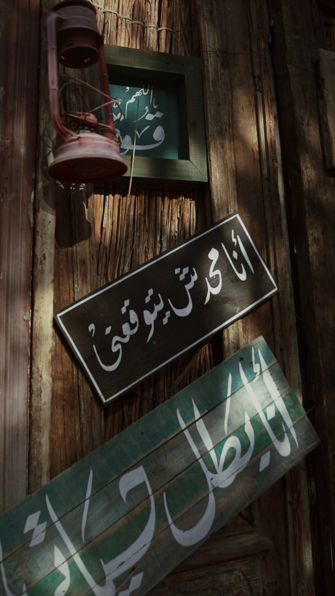
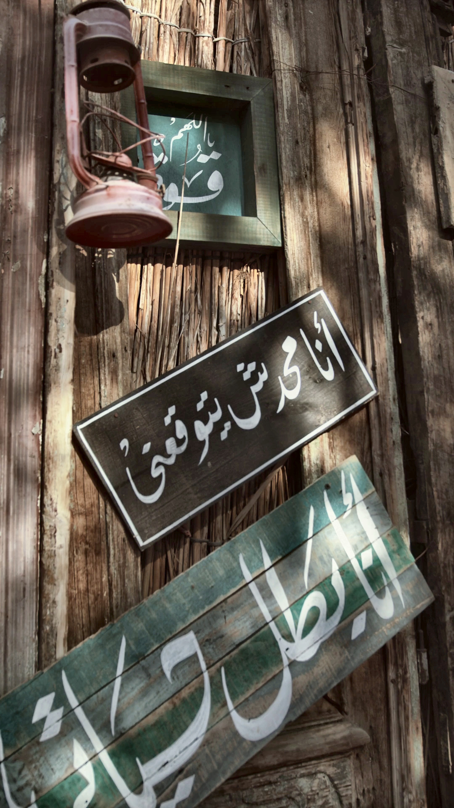
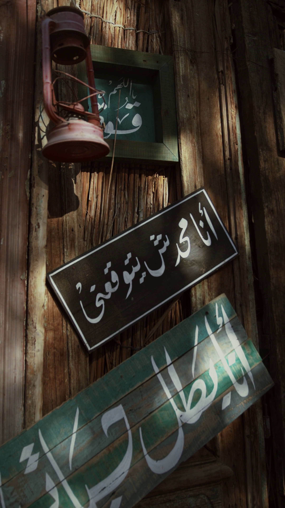
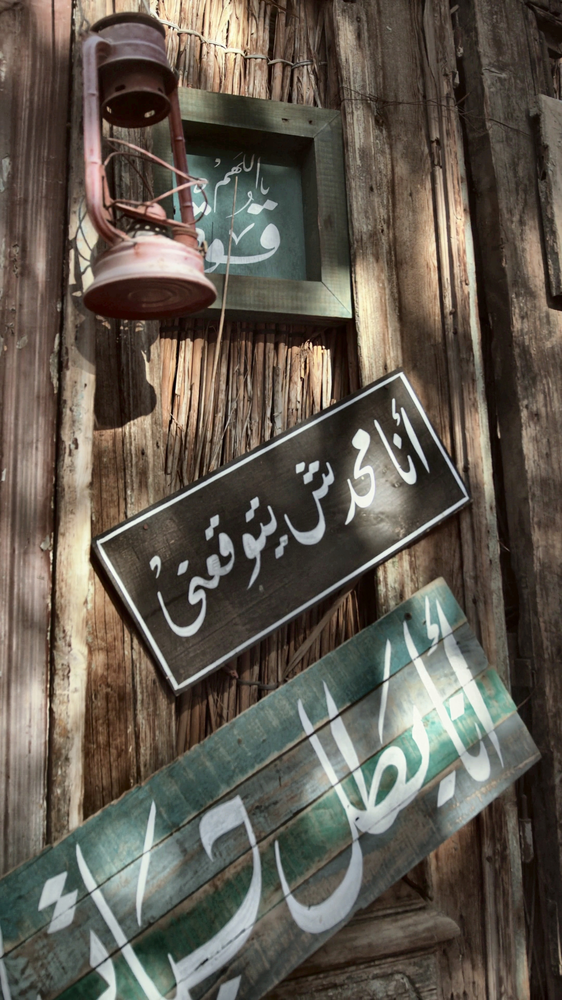
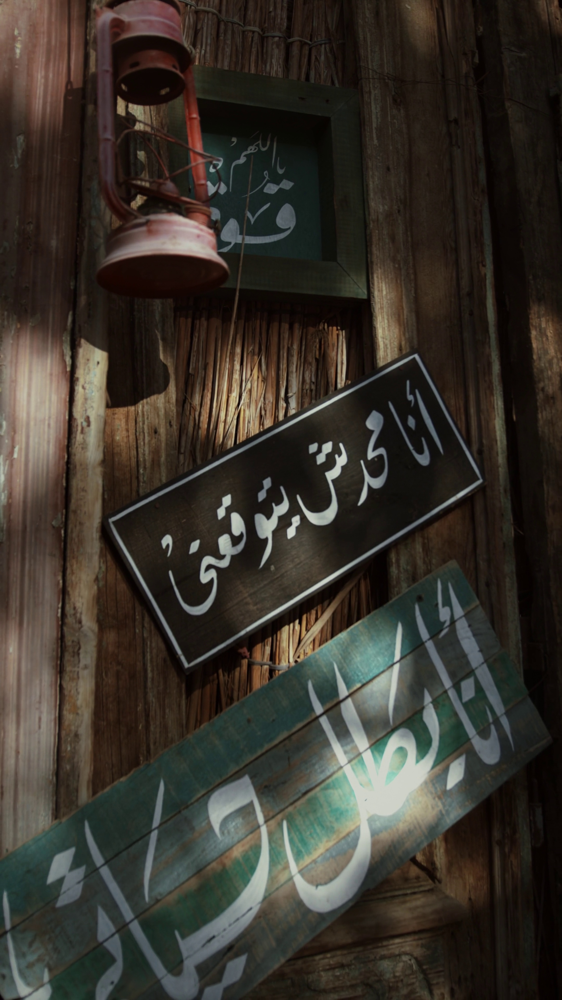
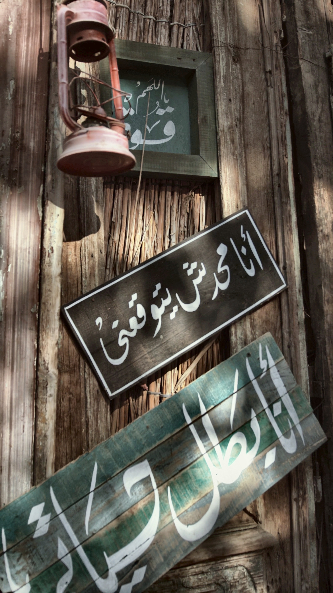
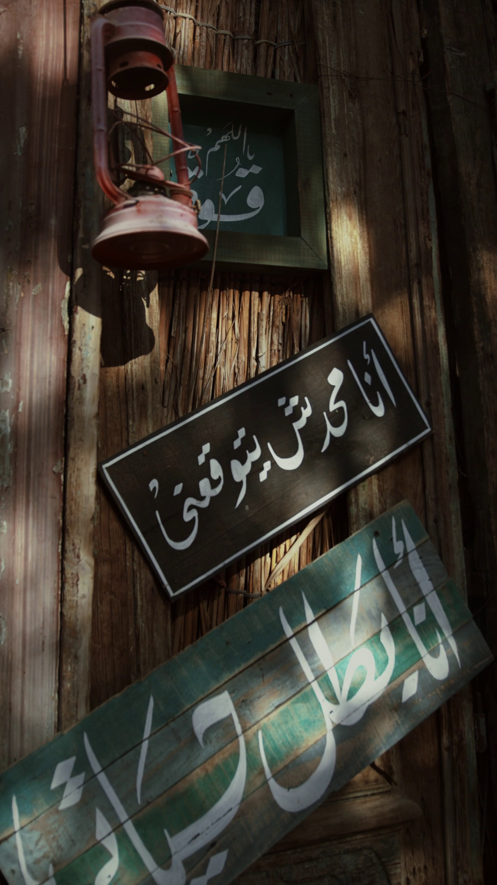
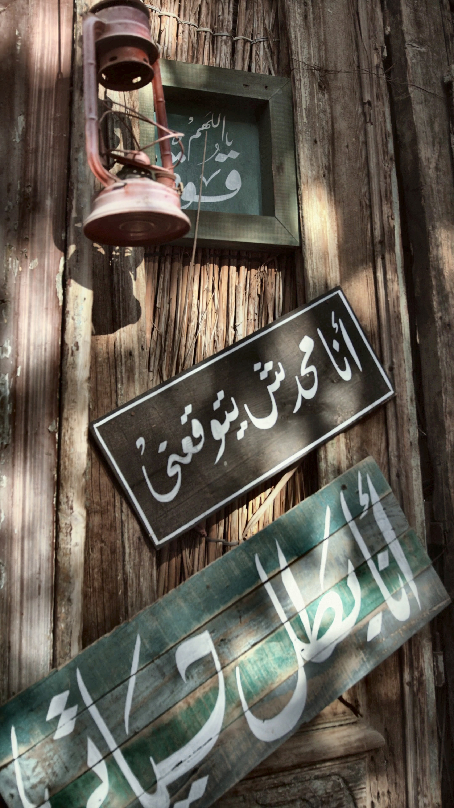
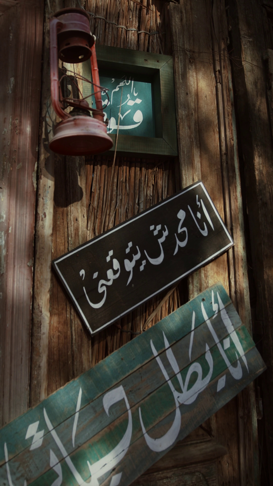
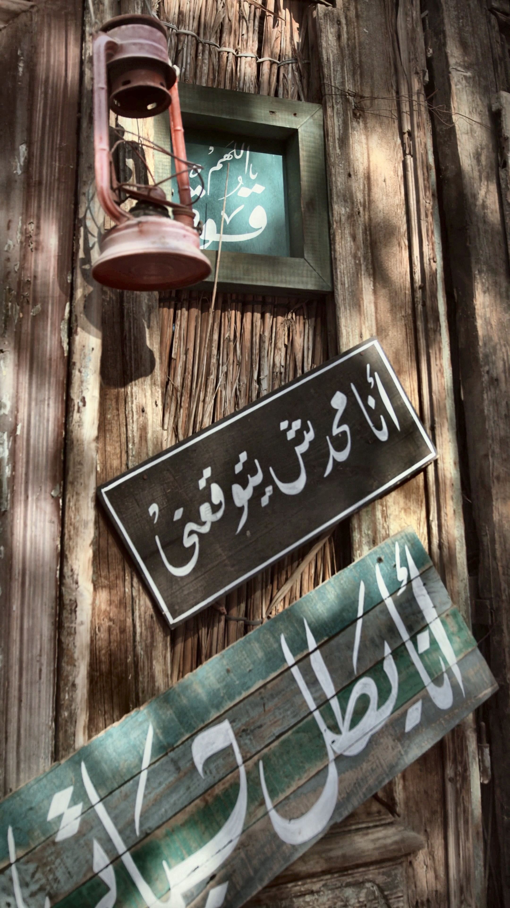

# VA-43 image enhancement evidence

Source: `C:/Users/user/Desktop/SEMESTER 7/Multimedia DB Project/vision-assistant/data/videos/arabic_sign.mp4`. Each pair is a real frame with mean brightness below 60.

| Frame | Time (s) | Mean brightness | Before | After | Operations |
|---|---:|---:|---|---|---|
| 1 | 0.0 | 50.2 |  |  | gamma, clahe |
| 2 | 1.0 | 51.2 |  |  | gamma, clahe |
| 3 | 8.0 | 51.9 |  |  | gamma, clahe |
| 4 | 7.0 | 53.5 |  |  | gamma, clahe |
| 5 | 6.0 | 54.8 |  |  | gamma, clahe |
